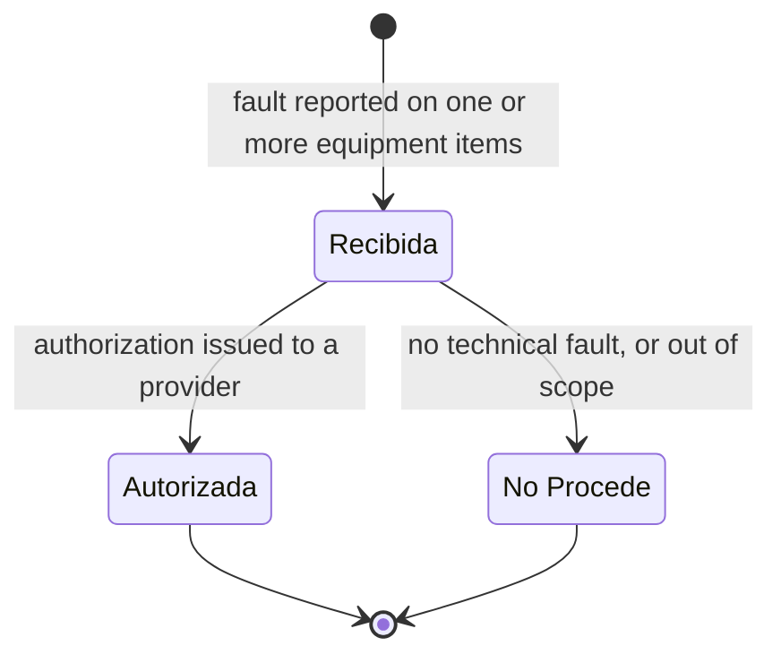
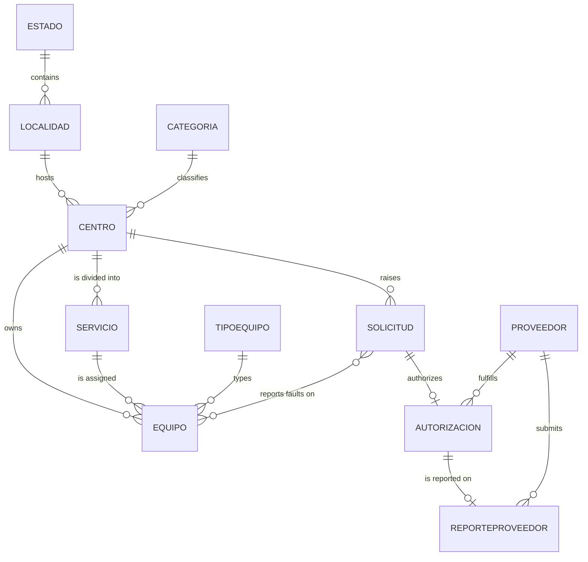

# MedTech Incident Manager

Incident management for medical equipment across the hospitals of a public health network.

Staff report a fault on specific pieces of equipment, the incident is reviewed and either authorized or dismissed, and authorized work is dispatched to an external service provider and tracked through to completion.

Built on **Laravel 5.1** following the framework's classic **MVC** pattern.

## Contents

- [What the application does](#what-the-application-does)
- [Domain model](#domain-model)
- [Architecture and modules](#architecture-and-modules)
- [Tech stack](#tech-stack)
- [Requirements](#requirements)
- [Installation](#installation)
- [Configuration](#configuration)
- [Demo credentials](#demo-credentials)
- [Useful commands](#useful-commands)
- [Project structure](#project-structure)
- [Multilanguage](#multilanguage)
- [Tests](#tests)
- [Credits](#credits)

## What the application does

The system manages the full life of an incident on a piece of medical equipment, across two linked stages.

**Stage 1 — the incident (`Solicitud`).** A request is opened against a hospital center and lists one or more pieces of equipment, each with its own reported fault (`falla_reportada`). It carries one of three statuses:



An incident becomes `Autorizada` as a side effect of issuing its authorization, and an incident marked `No Procede` is excluded from the pool of authorizable incidents.

**Stage 2 — the authorization (`Autorizacion`).** Issued against a single incident and assigned to an external provider, it is the record under which repair work actually happens. It tracks a richer set of states reflecting where the equipment physically is and what it is waiting on:

| Status | Meaning |
|---|---|
| `En Proceso` | Work under way |
| `Falta Repuesto` | Blocked waiting on a spare part |
| `Talleres` | Equipment moved to the provider's workshop |
| `Ejecutado` | Work completed |
| `No Procede` | Dismissed after inspection |

An incident can hold at most one authorization, enforced at the application layer by a uniqueness rule on `solicitud_id`.

Supporting this workflow, the application also manages the master catalogs the incidents are raised against — hospital centers and their departments, an equipment inventory, equipment types and categories, geographic locations, service providers, and users.

## Domain model



Reading it as a sentence: an `Estado` (state) contains `Localidad`es (localities), which host `Centro`s (hospital centers). A `Centro` belongs to a `Categoria` and is divided into `Servicio`s (hospital departments: radiology, surgery, ICU…). Each `Equipo` belongs to a `Centro`, is assigned to one of its `Servicio`s, and is of a given `TipoEquipo`.

A `Solicitud` is raised against a `Centro` and linked to the affected `Equipo`s through the `equipo_solicitud` pivot table, which stores the fault reported for each individual item. It is then authorized by a single `Autorizacion` assigned to a `Proveedor`, who in turn reports back through a `ReporteProveedor`.

## Architecture and modules

The project follows **MVC**: `app/Http/Controllers` (controllers), `app/*.php` (Eloquent models in the root `dgmtm` namespace), and `resources/views` (Blade views). Form validation is extracted into dedicated **Form Request** classes under `app/Http/Requests`.

Controllers are organized by business module:

| Module | Responsibility |
|---|---|
| `Auth/` | Login, logout, and password recovery |
| `Home/` | Dashboard; validates the user's `Activo`/`Inactivo` status before granting access |
| `Maestros/` | Master catalogs: `Centro`, `Estado`, `Localidad`, `Categoria`, `Proveedor`, `Servicio`, `TipoEquipo` and users |
| `Inventario/` | The `Equipo` inventory |
| `Solicitudes/` | Opening and tracking incidents, including the equipment-to-fault mapping |
| `Autorizaciones/` | Issuing authorizations and assigning them to providers |

Routes (`app/Http/routes.php`) are grouped by prefix and namespace per module (`maestros`, `inventario`, `solicitudes`, `autorizaciones`), all wrapped in the `language` middleware. Session protection is applied per controller via `$this->middleware('auth')` rather than at the route-group level.

Users carry one of two profiles (`Administrador`, `Usuario`) and an independent account status (`Activo`, `Inactivo`) that gates access to the dashboard.

## Tech stack

| Component | Technology |
|---|---|
| Framework | Laravel 5.1 (`laravel/framework`) |
| Language | PHP 7.4 (see [Requirements](#requirements)) |
| Authentication | Laravel Auth (session guard) |
| Views | Blade — SB Admin 2 admin template (Bootstrap) |
| Forms | `laravelcollective/html` |
| Assets | Gulp + Laravel Elixir (LESS compilation) |
| Database | MySQL / InnoDB |
| Multilanguage | Custom `LangMiddleware` (es/en) |
| Testing | [Pest](https://pestphp.com) (see [Tests](#tests)) |

## Requirements

- **PHP 7.4.** Laravel 5.1 relies on internal APIs (reflection-based dependency resolution) that are incompatible with PHP 8+: under PHP 8.x, `php artisan` fails with a fatal error. Use a PHP 7.x binary for `artisan`, Composer, and the test suite (with WAMP: `wamp64/bin/php/php7.4.33/php.exe`).
- Composer
- MySQL
- Node.js + npm (only to recompile assets with Gulp)
- A web server (Apache/WAMP), or `php artisan serve`

## Installation

```bash
# 1. Install PHP dependencies (with PHP 7.4, see Requirements)
composer install

# 2. Create the environment file and generate the application key
cp .env.example .env
php artisan key:generate

# 3. Configure the database in .env (see Configuration)

# 4. Create the schema
php artisan migrate
```

### Loading data

The repository ships a SQL dump with the schema and a small demo dataset — two hospital centers, their departments, an equipment inventory, and seven incidents in different states:

```bash
mysql -u <user> -p <database> < Basededatos/dgmtm.sql
```

The dump contains demo data only: no personal data. Note that `DatabaseSeeder` is empty, so `php artisan db:seed` loads nothing — the dump is the way to get a populated database.

### Running it

```bash
php artisan serve
```

Or point a VirtualHost at the `public/` directory.

## Configuration

Main variables in `.env`:

```
APP_ENV=local
APP_DEBUG=true
APP_KEY=

DB_HOST=localhost
DB_DATABASE=database_name
DB_USERNAME=user
DB_PASSWORD=password

CACHE_DRIVER=file
SESSION_DRIVER=file
QUEUE_DRIVER=sync

MAIL_DRIVER=smtp
MAIL_HOST=
MAIL_PORT=
MAIL_USERNAME=
MAIL_PASSWORD=
MAIL_ENCRYPTION=
```

## Demo credentials

Available after importing `Basededatos/dgmtm.sql`:

| Email | Password | Profile |
|---|---|---|
| `admin@medtech.local` | `demo1234` | Administrador |
| `usuario@medtech.local` | `demo1234` | Usuario |

Demo accounts for local use only.

## Useful commands

```bash
php artisan migrate            # Run pending migrations
php artisan migrate:rollback   # Roll back the last batch
php artisan route:list         # List all registered routes
php artisan clear-compiled     # Clear compiled classes
php artisan optimize           # Optimize the autoloader
```

## Project structure

```
app/
├── Http/
│   ├── Controllers/
│   │   ├── Auth/            # Authentication and passwords
│   │   ├── Home/            # Dashboard
│   │   ├── Maestros/        # Master catalogs
│   │   ├── Inventario/      # Equipment inventory
│   │   ├── Solicitudes/     # Incidents
│   │   └── Autorizaciones/  # Authorizations
│   ├── Requests/            # Form Request validation classes
│   ├── Middleware/          # Auth, LangMiddleware, CSRF
│   └── routes.php
├── *.php                    # Eloquent models (Centro, Equipo, Solicitud, ...)
Basededatos/
└── dgmtm.sql                # Schema + demo data
database/
├── migrations/              # 22 migrations
└── seeds/
resources/
├── lang/                    # es, en
└── views/                   # Blade, SB Admin 2 template
testing/                     # Pest suite, isolated (see Tests)
```

The PHP namespace is `dgmtm\`, retained from the project's original name.

## Multilanguage

The application supports **Spanish** and **English**. The locale is stored in the session and switched through the `lang/{es|en}` route; `LangMiddleware` applies it on every request. Translations live in `resources/lang/es` and `resources/lang/en`.

## Tests

Tests use **[Pest](https://pestphp.com)** and live in an **isolated Composer project** inside `testing/`, with its own `vendor/`.

The isolation is deliberate and necessary: Pest depends — through `nunomaduro/collision` — on `symfony/console` ^5, while Laravel 5.1 pins `symfony/console` to 2.7. The two cannot coexist in a single `vendor/`, so the test suite keeps its own dependency tree and boots the real application from `bootstrap/app.php` by hand. `testing/tests/TestCase.php` handles that bootstrap and exposes request helpers (`get`, `post`), session helpers (`actingAs`, `withCsrfToken`) and factory helpers for the domain entities.

Tests run against a dedicated MySQL database, recreated from the migrations on each test, rather than SQLite — this keeps `ENUM` handling, the InnoDB engine and foreign key behavior identical to production.

### One-time setup

```bash
# Dedicated database and user for tests
mysql -u root -e "CREATE DATABASE IF NOT EXISTS dgmtm_testing CHARACTER SET utf8 COLLATE utf8_unicode_ci;
CREATE USER IF NOT EXISTS 'dgmtm_test'@'localhost' IDENTIFIED BY 'dgmtm_test';
GRANT ALL PRIVILEGES ON dgmtm_testing.* TO 'dgmtm_test'@'localhost';"

# Install Pest in its isolated dependency tree
cd testing
composer install   # using PHP 7.4
```

Credentials can be overridden with `DB_TEST_HOST`, `DB_TEST_DATABASE`, `DB_TEST_USERNAME` and `DB_TEST_PASSWORD` for the application connection, plus `DB_TEST_ROOT_USERNAME` and `DB_TEST_ROOT_PASSWORD`, used only to recreate the database before each test.

### Running the suite

```bash
cd testing
vendor/bin/pest
```

Invoke it through a PHP 7.x binary if that is not what `php` resolves to, for example `wamp64/bin/php/php7.4.33/php.exe vendor/bin/pest`.

### Layout

```
testing/
├── composer.json      # only pestphp/pest and mockery
├── phpunit.xml
└── tests/
    ├── Pest.php
    ├── TestCase.php   # app bootstrap, request/DB/factory helpers
    ├── Unit/          # Models, validation rules, middleware
    └── Feature/       # Login, dashboard, end-to-end via the HTTP kernel
```

## Credits

Admin interface based on [SB Admin 2](http://startbootstrap.com/template-overviews/sb-admin-2/) by Start Bootstrap, on top of the [Laravel](https://laravel.com) framework.
